# Eucossa Mobile App

A Flutter mobile companion for [https://eucossa.com/](https://eucossa.com/). Focused on UI-first delivery of resources, communities, events and account flows. Use this README as the project summary and a UI-feature checklist.

## Project description

Mobile app to browse tech resources, join organized communities, follow hackathons, and manage account and privacy settings. UI is designed and prototyped in Flutter. Backend integrations are planned separately.

## Checklist — Features implemented

> The features whose UI is completed.

* [x] **Resources** — list view, PDF/notes card UI, resource details screen.
* [x] **Communities** — category list, community feed UI, message list mock.
* [x] **Privacy options** — privacy settings screen, toggles and explanations.
* [x] **Account options** — profile screen, edit profile UI, preferences page.
* [x] **Hackathons** — event list, event detail/card UI, registration mock.
* [x] **Credits** — contributors and acknowledgements page.
* [x] **Libraries used (UI page)** — dependencies list screen.
* [x] **Authentication (UI)** — login, signup, password reset screens.
* [ ] **Feedback / Contact Us** — feedback form UI and confirmation screen.

## Notes on checklist

* This checklist is UI-only. Checking an item means the screens and static flows exist.
* Backend, API, and real-time features are **not** implied by a checked box.

## App screenshots

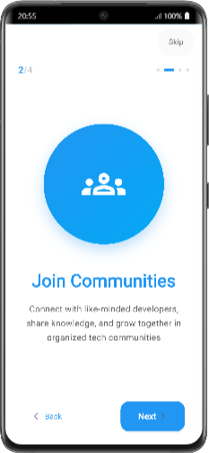
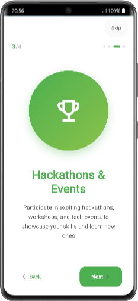
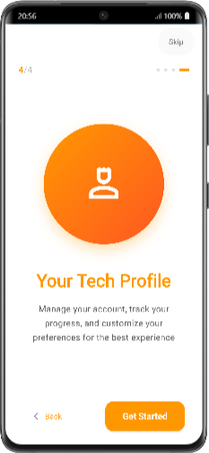
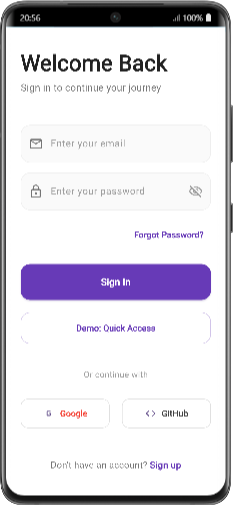
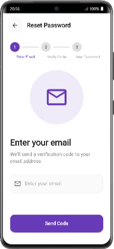
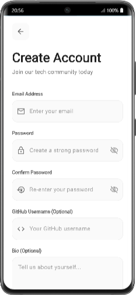
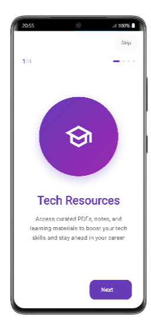
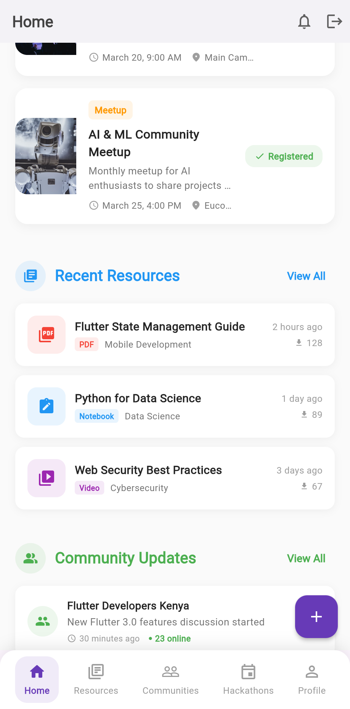
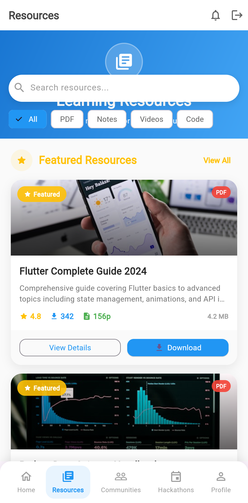
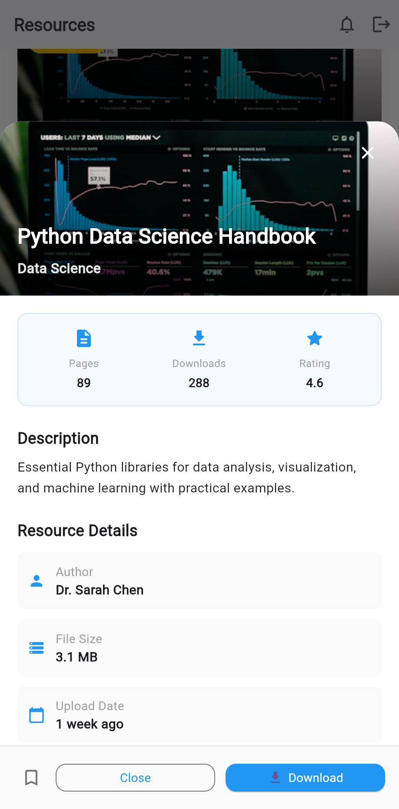
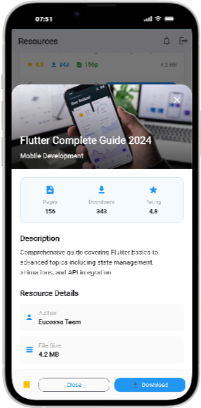
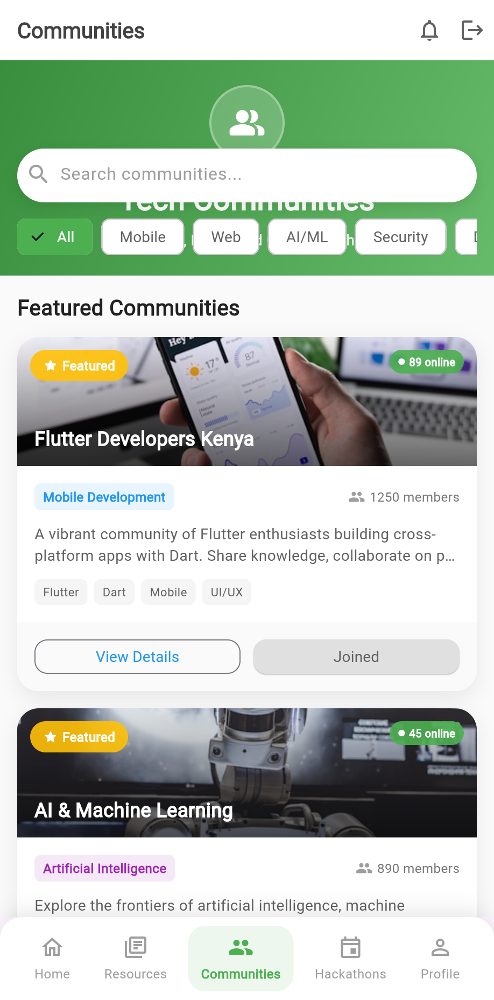
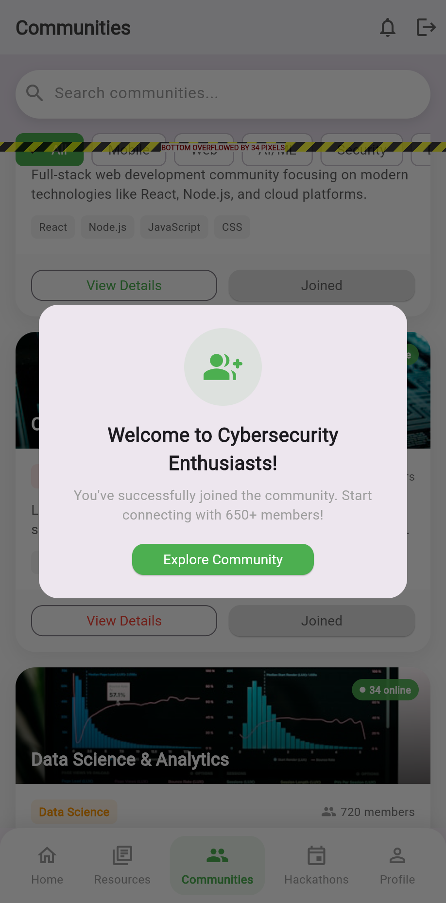
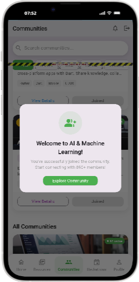
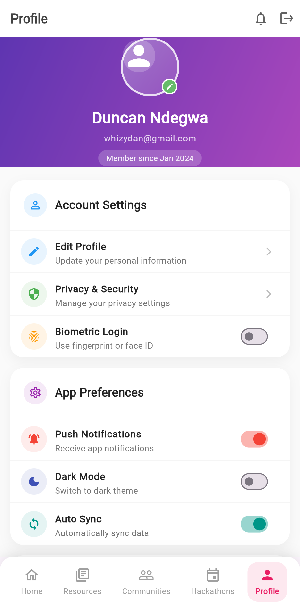
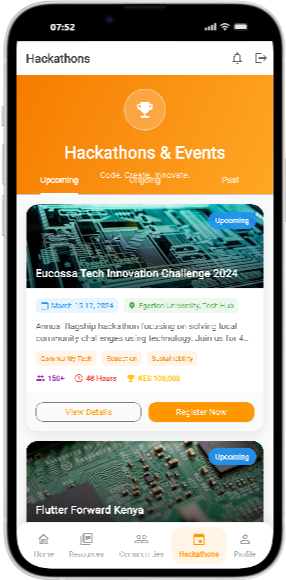
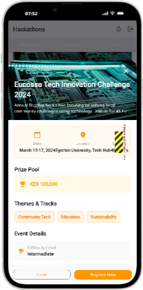
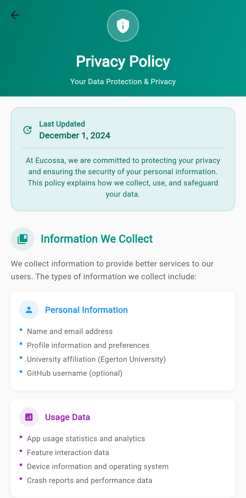
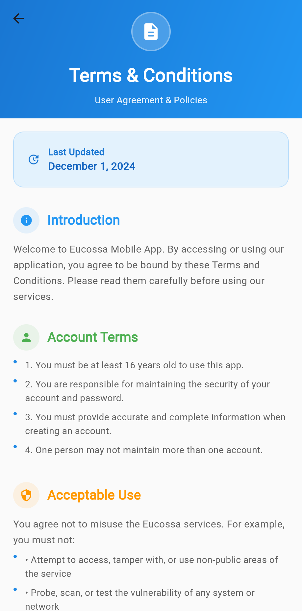
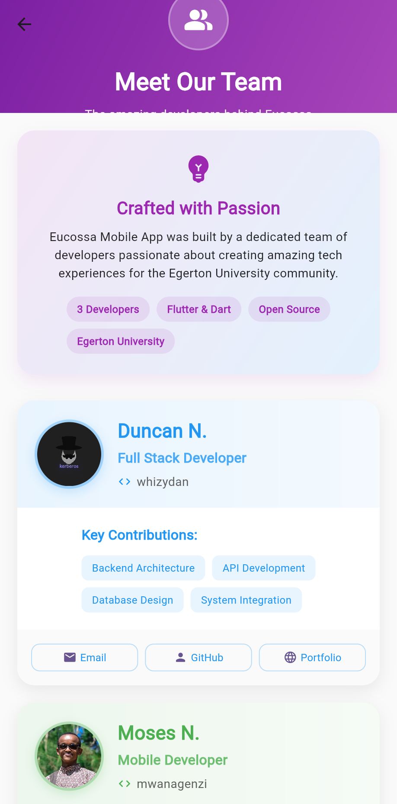
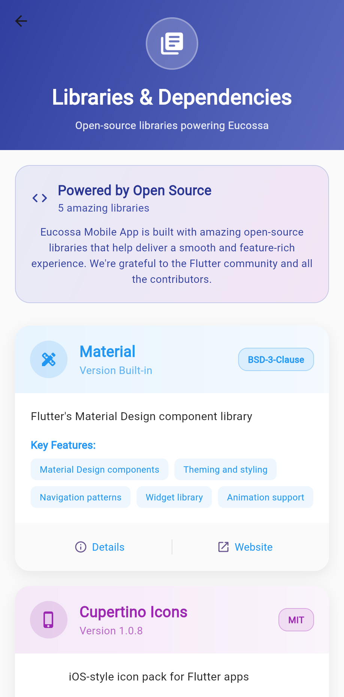
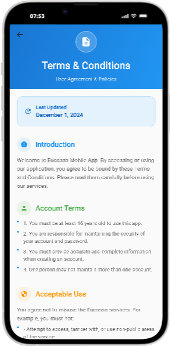
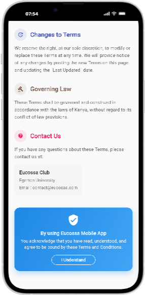
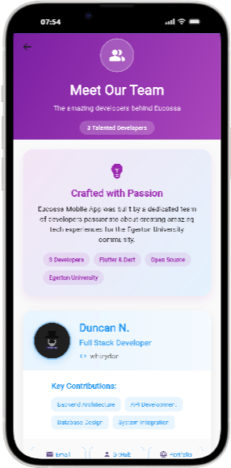
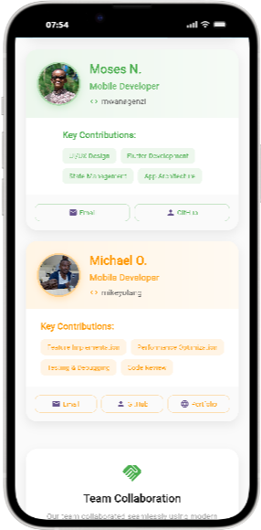
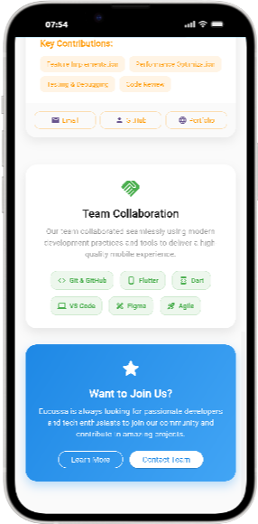
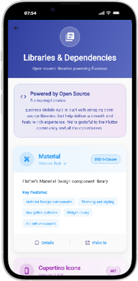
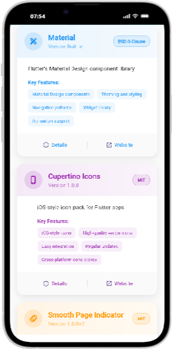
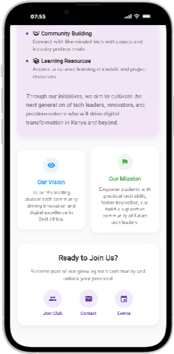
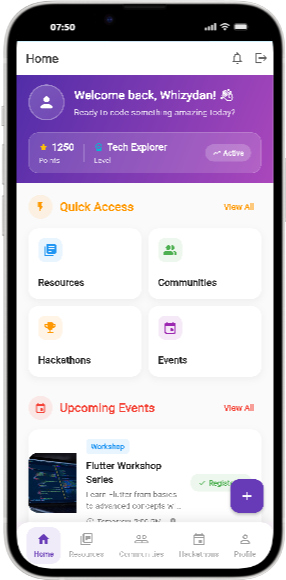


## Quick setup (UI preview)

```bash
git clone <repo>
cd EUCOSSA-flutter
flutter pub get
flutter run
```

## License

GPL-3.0
